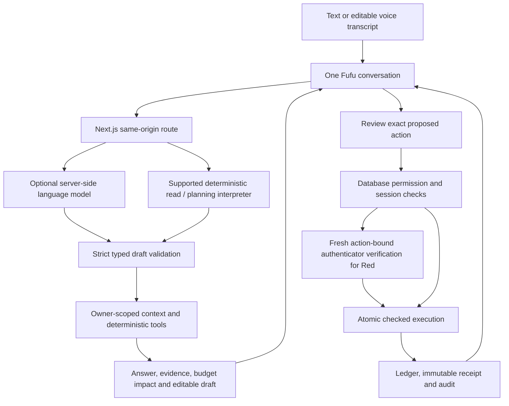

# Architecture, algorithms and execution design

## Product objective

Fufu is a banking agent delivered through a website: a user can choose a task or describe several needs in English or Chinese, refine a draft, inspect its impact and explicitly approve a supported change. Conversation is the interaction channel; typed tools, permissions and receipts provide the operational boundary. Financial values are fictional. No bank or merchant payment rail is connected.

## Architecture

The graph shows the authenticated route. Green reads do not traverse financial execution; Yellow changes require exact approval; Red changes also require a fresh action-bound grant. Every authenticated route retains its sign-in, owner and MFA/session baseline. A model response never constitutes customer approval.

- **Frontend:** Next.js 16, React 19, TypeScript; semantic light/dark theme, responsive layouts and existing Fufu mascot. One composer, chronological replies, message-anchored evidence and workflow controls.
- **Public simulation:** browser-local fictional accounts and effects, with a separate hosted conversation store. Browser data is user-editable and is not a secure ledger.
- **Authenticated banking:** Supabase Auth, PostgreSQL/RLS, owner-scoped context, private fixed-search-path helpers and public invoker wrappers. Conversation persistence is separate from database-owned execution receipts.
- **Language:** optional server-only OpenRouter/OpenAI adapter. The free hosted model can be unavailable; supported local read/planning patterns and task forms remain available. Arbitrary questions are not guaranteed.
- **Voice:** browser-side speech assets, English/Chinese transcription, editable text before explicit Send. Speech cannot submit, approve or satisfy MFA. First use has a sizeable model download; prepare it before judging.

## Core data and API boundaries

| Area | Representation / route | Authority |
|---|---|---|
| Context | Accounts, transactions, budgets, tuition, products, cards and registered subscriptions | Owner-scoped database retrieval in private mode; fictional browser snapshot in public mode |
| Conversation | Revision, messages, typed drafts, expiry; `/api/banking/conversation` or `/api/agent/demo-conversation` | Server validates updates; model cannot add execution privileges |
| Evidence | Bounded historical attachment on the assistant message, with dates and source limits | Explanatory snapshot; never accepted as execution authorization |
| Review/execution | Stored plan and pending action; `/api/banking/agent` and banking action routes | Database rechecks owner/session/state/policy and consumes exact approval |
| Workflows | Nodes, dependencies, revision and checkpoints; `/api/banking/workflow` | Each step uses checked execution; no unattended scheduler |
| Support | Ticket, chosen consent, messages, claim and operator membership | Customer ownership plus server-assigned operator scope; no financial approval delegation |

Source references: `src/agent/`, `src/server/agent-conversation-operations.ts`, `src/server/secure-banking.ts`, `src/features/copilot/`, `app/api/banking/`, `supabase/migrations/`. The implementation is the source of truth if an endpoint changes.

## Recurring-payment detector

1. Deduplicate transaction IDs. Accept settled positive consumption debits with valid dates; exclude credits, transfers, investment flows and unsettled entries.
2. Normalize merchant text using Unicode NFKC, case folding and punctuation/whitespace normalization. Group by account, currency and normalized merchant. This is deterministic string matching, not merchant-identity resolution.
3. Require at least two dated charges. Test weekly, monthly and yearly spacing. Monthly/yearly arithmetic clamps month-end dates; weekly tolerance is one day, monthly/yearly tolerance three days. At most one missing period is permitted between adjacent observations.
4. Use the median charge as the representative amount. Amount spread above 10%, missing periods, truncated history or a stale expected renewal reduce confidence. “High” requires at least three observations without those conditions; otherwise “possible”. These are heuristic labels, not calibrated probabilities.
5. Show a projected renewal window, reasons and up to three supporting charges for each of up to three candidates. Registered subscriptions are separately labelled with their cancellation capability. A pattern alone never establishes a merchant contract, usage or a cancellation API.

The explicit fictional-history loader adds labelled historical fixtures without debiting opening balances; it invalidates old financial plans through the context version. It is for reproducibility, not proof of an external data integration.

## Conversation and calculation

Validated intent updates have an allowlisted task kind and bounded fields. Follow-up edits retain unrelated draft tasks. Supported deterministic queries bypass the model, including recurring-payment/evidence requests; mixed read/write requests are not silently reduced to a read. Duplicate read refreshes reuse their draft, while each reply keeps its historical evidence attachment. Attachments are bounded and new evidence requests near the conversation storage limit ask for a new conversation instead of pruning old evidence.

Amounts use integer minor units/BigInt: two decimals for CNY/USD/SGD and whole rupiah for IDR. Cash coverage subtracts known tuition, proposed outflows and explicitly included hypothetical spending. Consumption-budget headroom is separate: transfers and investments are not automatically consumption. Currency checks are separate; no exchange or future income is assumed. Missing budgets, incomplete purchase coverage and record dates remain visible.

## Approval, execution and recovery

The system separates intent, draft, prepared action, explicit decision, checked execution and verified receipt. Pending actions expire and bind to canonical payload/state. Database row locks serialize owner decisions. Duplicate submissions return the original effect/receipt rather than replaying it. A stale state requires fresh review.

Persistent workflows store a topologically indexed dependency graph, defaulting to sequential steps. A bounded command advances one ready node. Pause, cancel or support takeover blocks further execution; reload resumes from checkpoints rather than replaying completed effects. Recovery proposes a separate compensating action for supported own-account transfer/budget/card effects. It preserves original ledger history and requires fresh approval/policy checks. Later conflicting state and irreversible/unsupported operations require manual review. This is not universal transactional rollback.

## Security model

Green covers read operations. Yellow needs exact approval, including permitted CNY transfer/tuition totals up to and including ¥1,000 per day in Asia/Shanghai. Higher totals, unsupported FX evidence, investment changes and card freeze/unfreeze are Red. Red requires a one-use grant bound to owner, session, action, payload hash, state version and policy, with a newer verified authenticator event. All private writes retain recent MFA/session checks even when their permission tier is Yellow.

Sensitive failures are recorded outside the rolled-back business subtransaction. Repeated failures can lock actions; suspicious tampering can require operator review and fresh owner verification. Operators need explicit private membership, MFA and a valid ticket claim. Operators can advise, reply and release a handoff; they cannot approve customer money movement. See the self-assessment for tests, acceptance limits and threat coverage.

## Failure behavior

Model timeouts/configuration/rate-limit failures produce a conversational explanation, not a success claim. Missing entities or ambiguous recipients require clarification. Unsupported merchant payments/cancellations are declined with support access and planning alternatives. Stale/expired actions cannot be reused. Partial workflows retain completed receipts and show the remaining work. Unknown verification results direct the user to activity before retrying.
